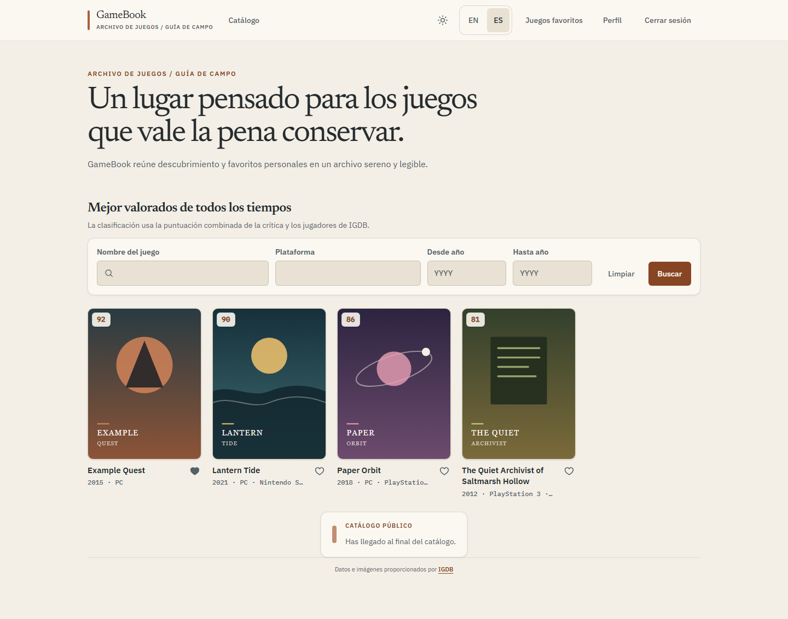
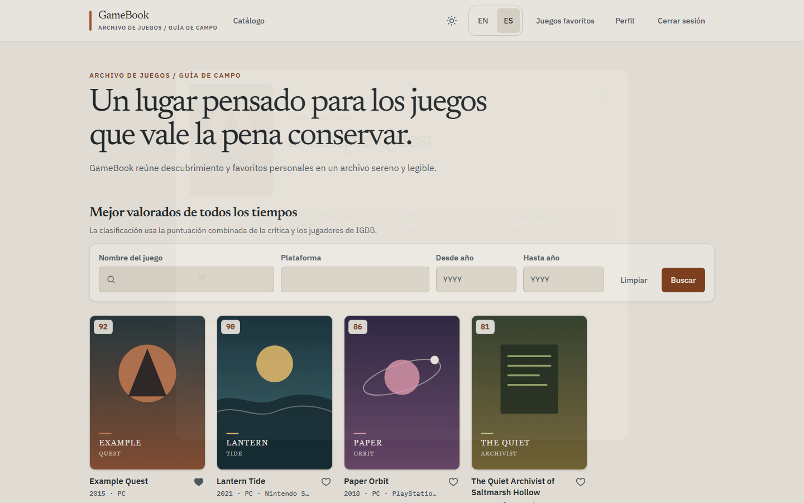
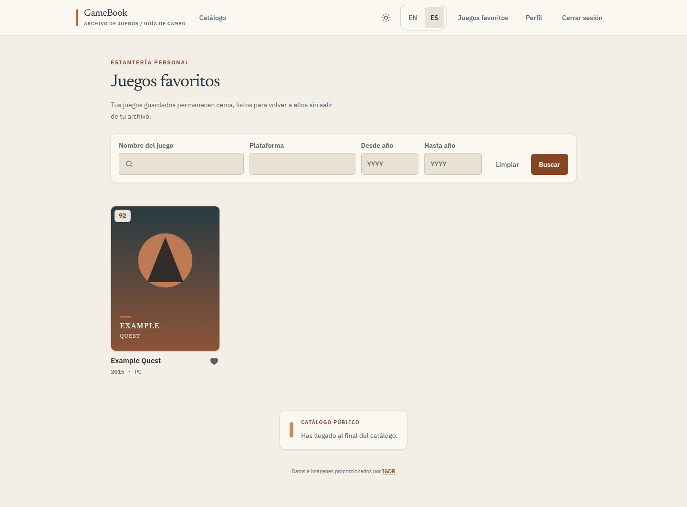

# GameBook

[English](README.md) · **Proyecto de portfolio · últimas versiones: Frontend v0.12.0, AuthUser v0.4.0, Game v0.4.0**


GameBook es un pequeño sistema full stack para un portfolio, construido con desarrollo guiado por especificaciones. Permite explorar los juegos mejor puntuados de IGDB, iniciar sesión y mantener una colección personal de favoritos.

## Qué hace

- Muestra un catálogo público con detalles, búsqueda y filtros por plataforma y año de lanzamiento.
- Permite crear una cuenta, iniciar sesión y administrar los juegos favoritos propios.
- Usa IGDB para la información de juegos y PostgreSQL para las cuentas y los favoritos guardados.
- Ofrece una interfaz en inglés y español, con temas claro y oscuro.

## Demo y documentación de API

- **Aplicación:** [gamebook-frontend.vercel.app](https://gamebook-frontend.vercel.app)
- **Swagger de AuthUser:** [gamebook-microservice-authuser.onrender.com/docs](https://gamebook-microservice-authuser.onrender.com/docs)
- **Swagger de Game:** [gamebook-microservice-game.onrender.com/docs](https://gamebook-microservice-game.onrender.com/docs)
- **Diagramas de arquitectura:** [índice interactivo de diagramas](https://carlossv923.github.io/GameBook.System/)

Las API de backend funcionan en el nivel gratuito de Render; la primera solicitud puede tardar un poco más mientras los servicios se activan.

## Capturas

| Catálogo                                               | Detalle del juego                                    | Favoritos                                                     |
| ------------------------------------------------------ | ---------------------------------------------------- | ------------------------------------------------------------- |
|  |  |  |

## Repositorios

| Repositorio                                                                                     | Función                                                  | Tecnologías                       | Despliegue                  |
| ----------------------------------------------------------------------------------------------- | -------------------------------------------------------- | --------------------------------- | --------------------------- |
| [GameBook.Frontend](https://github.com/CarlosSV923/GameBook.Frontend)                           | Catálogo web, interfaz de cuenta y favoritos             | Next.js, React, TypeScript        | Vercel desde `main`         |
| [GameBook.Microservice.AuthUser](https://github.com/CarlosSV923/GameBook.Microservice.AuthUser) | Cuentas, autenticación y validación de sesión            | NestJS, TypeScript, Prisma        | Render desde `main`         |
| [GameBook.Microservice.Game](https://github.com/CarlosSV923/GameBook.Microservice.Game)         | Favoritos de usuario e instantáneas de juegos            | NestJS, TypeScript, Prisma        | Render desde `main`         |
| [GameBook.System](https://github.com/CarlosSV923/GameBook.System)                               | Documentación del sistema, diagramas e integración local | Markdown, Archify, Docker Compose | GitHub Pages para diagramas |

## Arquitectura

[](https://carlossv923.github.io/GameBook.System/GameBook.System-architecture-es.html)

El navegador consulta los datos públicos de IGDB a través del servidor Next.js; las credenciales de aplicación de Twitch permanecen solo en ese servidor. AuthUser firma JWT RS256 y Game verifica la firma y solicita a AuthUser validar la sesión actual antes de servir favoritos protegidos. Ambos servicios usan esquemas separados y roles de runtime limitados en una misma base de datos PostgreSQL de Neon; las migraciones se ejecutan solo mediante sus workflows de GitHub Actions.

Abre el [diagrama interactivo en español](https://carlossv923.github.io/GameBook.System/GameBook.System-architecture-es.html) o consulta el [índice de diagramas](https://carlossv923.github.io/GameBook.System/).

## Compose local

El stack de Compose construye las tres aplicaciones desde repositorios hermanos e inicia una base PostgreSQL local. Copia `.env.example` a `.env`, configura valores locales privados y ejecuta:

```bash
docker compose up --build -d
docker compose ps
```

La aplicación queda disponible en `http://localhost:3000`, con AuthUser y Game en los puertos `3001` y `3002`. Compose no ejecuta migraciones de base de datos. Consulta la [guía de desarrollo en español](docs/development.es.md) para la configuración, las migraciones y el restablecimiento.

## Tecnologías y decisiones

| Área              | Opción                           | Motivo                                                                          |
| ----------------- | -------------------------------- | ------------------------------------------------------------------------------- |
| Aplicación web    | Next.js y TypeScript             | Renderizar el catálogo público y proteger las credenciales IGDB en el servidor. |
| Servicios         | NestJS y TypeScript              | Mantener las responsabilidades de cuentas y favoritos en API independientes.    |
| Persistencia      | PostgreSQL y Prisma              | Asignar a cada servicio su propio esquema y workflow de migración.              |
| Identidad         | JWT RS256 y validación de sesión | Permitir que Game verifique tokens y respete la revocación de AuthUser.         |
| Integración local | Docker Compose                   | Ejecutar juntas las aplicaciones y PostgreSQL local.                            |
| Despliegue        | Vercel, Render y GitHub Actions  | Desplegar cada aplicación por separado y ejecutar migraciones controladas.      |

## Desarrollo guiado por especificaciones

Las especificaciones, los planes y el registro de tareas guían cada subtarea ejecutable y sus dependencias. Consulta [`specs/`](specs/), [`plan/`](plan/), [`tasks/`](tasks/), [`contracts/`](contracts/) y [`environments/`](environments/) para los requisitos, decisiones de implementación, contratos de API y persistencia y la política de ambientes.

Licencia [MIT](LICENSE) · © Carlos Sesme Vera.
