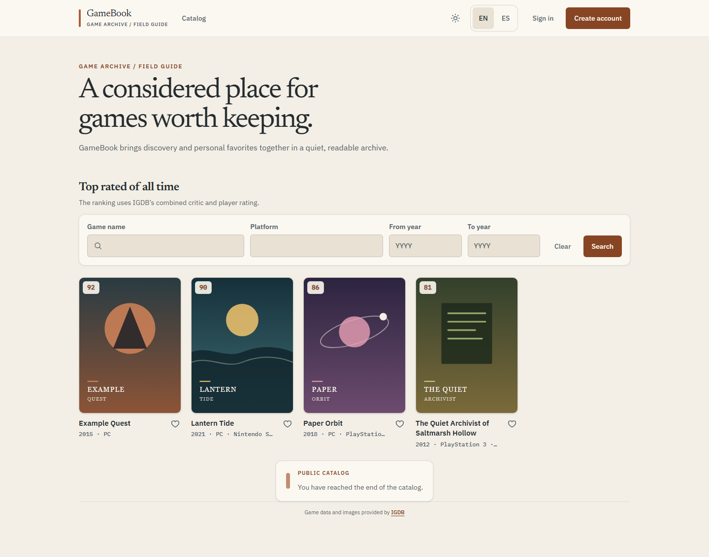
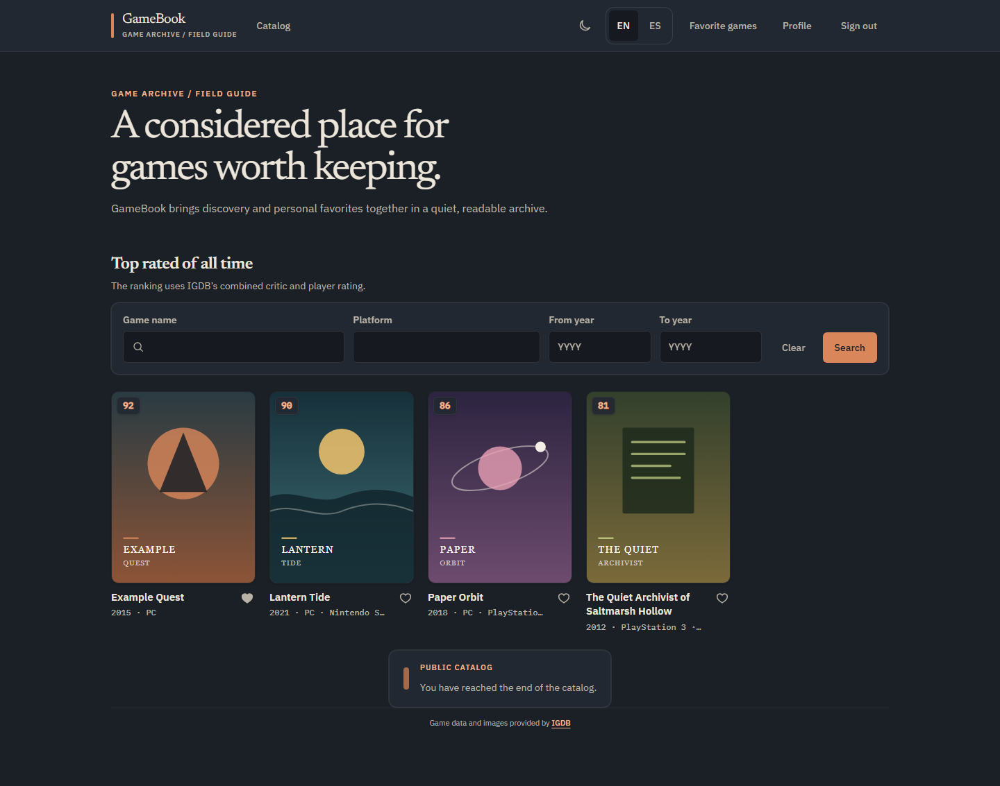
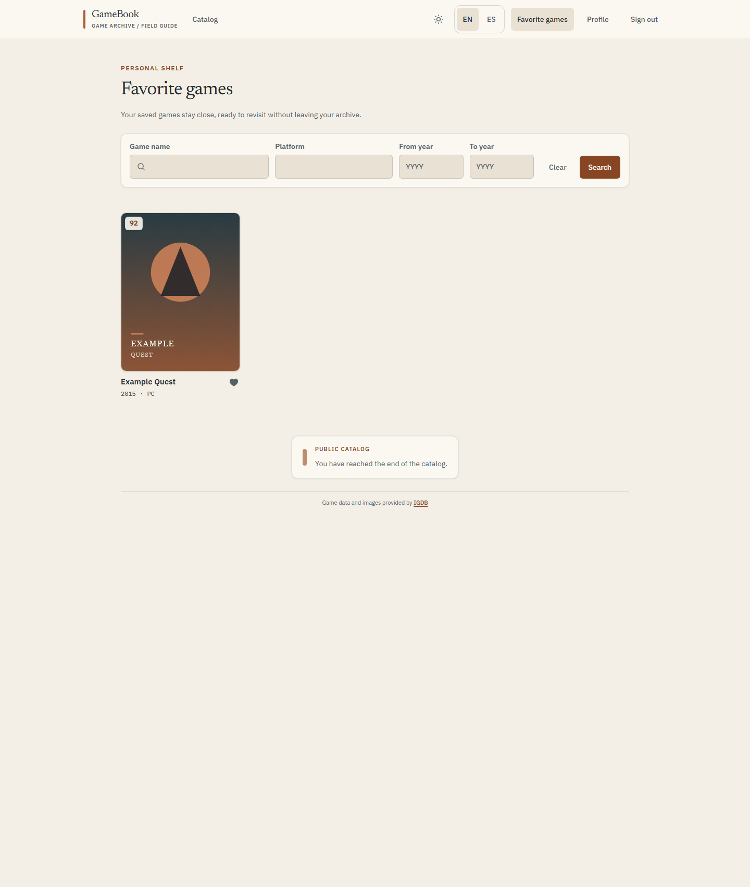

# GameBook

[Español](README.es.md) · **Portfolio project · latest releases: Frontend v0.12.0, AuthUser v0.4.0, Game v0.4.0**


GameBook is a small full-stack portfolio system built with spec-driven development. Browse top-rated games from IGDB, sign in, and keep a personal favorites shelf.

## What it does

- Shows a public game catalog with details, search, platform and release-year filters.
- Lets people create an account, sign in, and manage their own favorite games.
- Uses IGDB for game information and PostgreSQL for accounts and saved favorites.
- Provides an English and Spanish interface with light and dark themes.

## Live demo and API docs

- **Live app:** [gamebook-frontend.vercel.app](https://gamebook-frontend.vercel.app)
- **AuthUser Swagger:** [gamebook-microservice-authuser.onrender.com/docs](https://gamebook-microservice-authuser.onrender.com/docs)
- **Game Swagger:** [gamebook-microservice-game.onrender.com/docs](https://gamebook-microservice-game.onrender.com/docs)
- **Architecture diagrams:** [interactive diagram index](https://carlossv923.github.io/GameBook.System/)

The backend APIs run on Render's free tier, so their first request may take a little longer while the services warm up.

## Screenshots

| Catalog                                          | Catalog · dark                                                 | Game detail                                    | Favorites                                             |
| ------------------------------------------------ | -------------------------------------------------------------- | ---------------------------------------------- | ----------------------------------------------------- |
|  |  |  |  |

<p align="center"></p>

## Repositories

| Repository                                                                                      | Role                                                 | Stack                             | Deployment                |
| ----------------------------------------------------------------------------------------------- | ---------------------------------------------------- | --------------------------------- | ------------------------- |
| [GameBook.Frontend](https://github.com/CarlosSV923/GameBook.Frontend)                           | Web catalog, account UI and favorites                | Next.js, React, TypeScript        | Vercel from `main`        |
| [GameBook.Microservice.AuthUser](https://github.com/CarlosSV923/GameBook.Microservice.AuthUser) | Accounts, authentication and session validation      | NestJS, TypeScript, Prisma        | Render from `main`        |
| [GameBook.Microservice.Game](https://github.com/CarlosSV923/GameBook.Microservice.Game)         | User favorites and game snapshots                    | NestJS, TypeScript, Prisma        | Render from `main`        |
| [GameBook.System](https://github.com/CarlosSV923/GameBook.System)                               | System documentation, diagrams and local integration | Markdown, Archify, Docker Compose | GitHub Pages for diagrams |

## Architecture

[](https://carlossv923.github.io/GameBook.System/GameBook.System-architecture-en.html)

The browser calls the Next.js server for public IGDB data; Twitch application credentials stay only on that server. AuthUser signs RS256 JWTs, and Game verifies the signature and asks AuthUser to validate the current session before serving protected favorites. Both services use separate schemas and limited runtime roles in one Neon PostgreSQL database; migrations run only through their GitHub Actions workflows.

Open the [interactive English diagram](https://carlossv923.github.io/GameBook.System/GameBook.System-architecture-en.html) or browse the [diagram index](https://carlossv923.github.io/GameBook.System/).

## Local Compose

The Compose stack builds the three application repositories from sibling checkouts and starts them with a local PostgreSQL database. Copy `.env.example` to `.env`, set private local values, then run:

```bash
docker compose up --build -d
docker compose ps
```

The app is available at `http://localhost:3000`, with AuthUser and Game on ports `3001` and `3002`. Compose does not run database migrations. See the [English development guide](docs/development.md) for setup, migration and reset details.

## Stack and decisions

| Area              | Choice                            | Reason                                                               |
| ----------------- | --------------------------------- | -------------------------------------------------------------------- |
| Web application   | Next.js and TypeScript            | Render the public catalog and keep IGDB credentials server-side.     |
| Services          | NestJS and TypeScript             | Keep account and favorites responsibilities in independent APIs.     |
| Persistence       | PostgreSQL and Prisma             | Give each service its own schema and migration workflow.             |
| Identity          | RS256 JWT and session validation  | Let Game verify tokens and honor session revocation by AuthUser.     |
| Local integration | Docker Compose                    | Run the application repositories together with local PostgreSQL.     |
| Delivery          | Vercel, Render and GitHub Actions | Deploy each application independently and run controlled migrations. |

## Spec-driven development

Specifications, plans and task records guide each executable subtask and its dependencies. See [`specs/`](specs/), [`plan/`](plan/), [`tasks/`](tasks/), [`contracts/`](contracts/) and [`environments/`](environments/) for requirements, implementation decisions, API and persistence contracts, and environment policy.

Licensed under the [MIT License](LICENSE) · © Carlos Sesme Vera.
